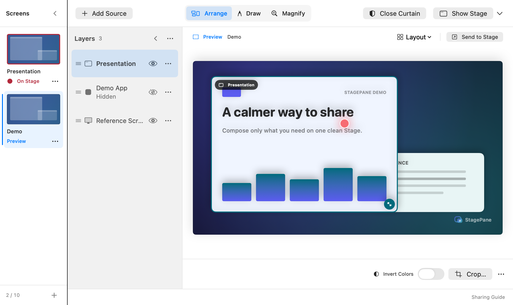
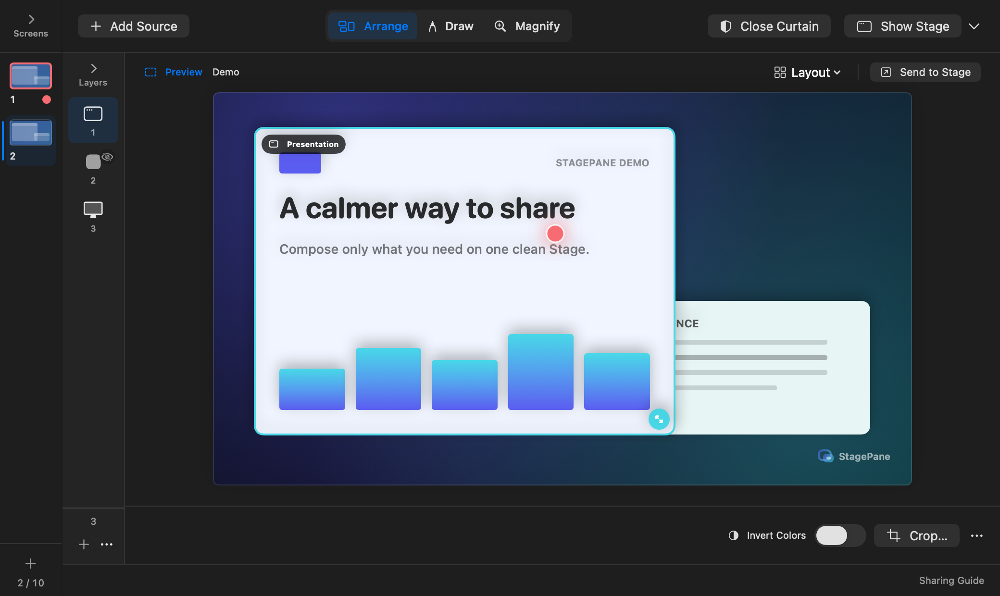
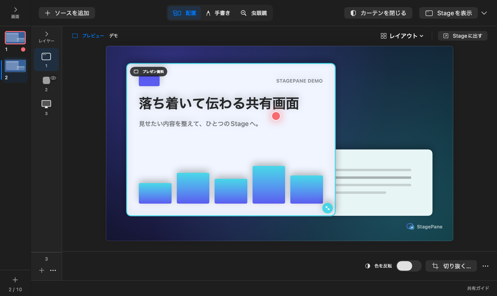

# Screen group implementation review

Reviewed locally on 2026-11-07. This is a feature validation record, not a
release acceptance record.

## Behavior

- The first group counts toward Free's two-group limit or Pro's ten-group limit.
  The existing source limit applies within each group.
- Workspace's leftmost tabs select the private editor. Send to Stage explicitly
  routes that group into the same audience window. Selecting or editing another
  group does not change the output's theme, shape, ink, or magnifier. Editing
  the output group still applies immediately. The global Curtain is preserved.
- Compact layout thumbnails replace large number cards. Blue indicates the
  selected editor; a red frame and On Stage label indicate routing. These
  indicators stay outside the audience canvas. The shield indicates Curtain,
  and labels do not claim to detect sharing in a meeting app. Tab thumbnails
  draw layer placement without reading pixels or creating extra capture streams.
- Screens and Layers each collapse to a 64-point strip with a header chevron.
  Compact screen tabs keep schematic thumbnails, numbering, and the red output
  border; compact layers keep source icons, numbering, and hidden/attention/color
  indicators. Tooltips expose names, and selection/context-menu actions remain
  available. Each collapsed state is a local preference across groups and app
  launches; the expanded layer width is retained separately. Only Workspace
  layout changes, without changing output routing, capture, or crop state.
- Switching editor tabs ends gestures and discards an unapplied crop draft.
  Send to Stage requires applying or cancelling a crop first. Group changes and
  output routing are blocked during source selection, an image export, a
  full-screen transition, or group teardown.
- Inactive groups keep capturing. The status item and Access & Privacy pane
  include their activity. Stop All and Quit end capture across all groups.
- Matching picker-authorized single windows share one native capture input
  across layers and groups on macOS 15.2+. Identity uses window ID and owning
  process ID, not title or size. Older systems and other filter types reuse
  only the identical filter object. Native cursor inclusion stays isolated.
  Active layers request their own bounded sizes; the input uses the maximum
  width and height, and fans out references to the same sample buffer. Crop,
  placement, color effects, and paired renderers remain local to each layer.
- Hiding or removing one layer leaves other subscribers running. The last
  active subscription stops the input and clears its retained frame. Resuming
  an input that was stopped waits for new pixels; joining a running static
  input reuses its current complete frame. Application replacements change only
  the requested layer; system-menu replacements reach all layers on that input.
  A terminal native callback immediately revokes all their snapshot access.
- Deleting the output group closes the Curtain and routes to an available
  group. Deleting a preview-only group preserves output and Curtain. A failed
  stop keeps the group available for retry. The final group cannot be deleted.
- Pro revocation locks groups after the first two and ends their capture while
  retaining their in-memory layout and ink. If output becomes unavailable, the
  Curtain closes and Stage uses the first group; an unavailable preview alone
  does not interrupt valid output. Restoring Pro requires fresh source selection.
  Groups are not persisted after quitting.

## Automated validation

- `./Scripts/release-check.sh` (via `./build.sh`): 291 tests passed, including controller group
  limits, isolated ink and settings, downgrade/restore, deletion, all-group
  teardown, picker ownership, and cancellation after a replacement disappears.
  Existing capture presentation, revocation, and snapshot tests, plus the 19
  shared-input tests described below, also passed.
- Rendering tests verify that editing a preview does not change the audience
  image; only Send to Stage changes it, preserving NSWindow identity. An actual
  controller/window integration test verifies that output geometry and maximize
  use the output preset even when another tab is being edited. Ink and magnifier
  routing, both downgrade paths, and picker/full-screen routing guards are covered.
- `swift build -Xswiftc -strict-concurrency=complete -Xswiftc -warnings-as-errors`
  passed.
- The existing local `./build.sh` entrypoint produced the development app.
- The App Store scheme built unsigned for arm64 and x86_64 using a generic macOS
  destination and `ONLY_ACTIVE_ARCH=NO`. No archive or upload was performed.
- XcodeGen 2.45.4 regenerated the project for the three new app files; the drift
  lock and project/source checks passed.

Input reuse has 19 additional tests using an injected native-stream driver and
synthetic BGRA frames. They cover ten subscriptions sharing one creation/start,
maximum resolution aggregation, no update for a smaller layer's resize, crop
and color independence, static-frame reuse, all-paused restart, last-subscriber
cleanup, failed start/resume/stop retry, a larger subscriber's configuration
failure, queued frames after replacement, cursor-mode isolation/rejoining,
static laser transitions, system replacement across groups, and terminal
revocation. These tests validate sharing and lifecycle behavior without desktop
capture; they do not measure real CPU, GPU, or WindowServer savings.

## Visual and interactive validation

Synthetic `--snapshot` output was inspected in Japanese and English, in light
and dark appearances, at 1440 × 900 and 1040 × 620 points. Group tabs, selected
state, independent output/preview markers, Send to Stage, add/menu actions, and
Free/Pro comparison values fit these layouts. Both editing a separate preview
and editing the output group are covered. Fixture images contain no real
captured windows.

Compact-rail fixtures cover each column separately and both together at
1040 × 620 points, in Japanese/English and light/dark appearances. Native
interaction checks cover independent collapse/expand, Up/Down selection and
context menus on compact screen tabs, retained state after adding/switching
groups, and layer width restoration after a 280-point resize. Restarting an
isolated development instance restored both compact states. Accessibility
exposes the controls as buttons with expanded/compact values. Interactive
checks used a separate development instance without live capture.

The local app's add, select, rename, Send to Stage, and delete-confirmation/cancel
controls were exercised. Up/Down selects the editor in both directions without
moving the output marker. Send to Stage moves the output marker and preserves
Curtain. Accessibility exposes names, editing/output states, contextual tool
help, and labeled add/menu controls. Full VoiceOver speech/navigation, system Increase Contrast/Reduce
Motion settings, real capture permission transitions, live multi-group stream
retention, and meeting-app sharing still require manual acceptance on a release
candidate. Automated and synthetic checks do not replace those checks.

## Release preparation follow-up

For the 0.5.0 (14) candidate, the source and strict-concurrency gates passed
with all 291 tests, and the unsigned Store Release build passed for arm64 and
x86_64. Both language runs produced 61 opaque PNGs, matched against the updated
CI manifest at 1040 × 620 and 1440 × 900 points. The snapshot renderer now allows
AppKit-backed controls to settle before caching, fixing incomplete Japanese
button rendering seen during this check. Selected expanded/compact and product
fixtures were inspected after the change. These remain synthetic checks.

The website's Japanese/English plans and image loading were checked in a local
browser. Both now state two Free screens with four sources each and ten Pro
screens, and the privacy text distinguishes layer presentation from retained
shared input. The exact-candidate release matrix is in
[RELEASE_0.5.0_ACCEPTANCE.md](RELEASE_0.5.0_ACCEPTANCE.md) and remains unaccepted.

Synthetic review images (source-build access, not StoreKit purchase evidence):

