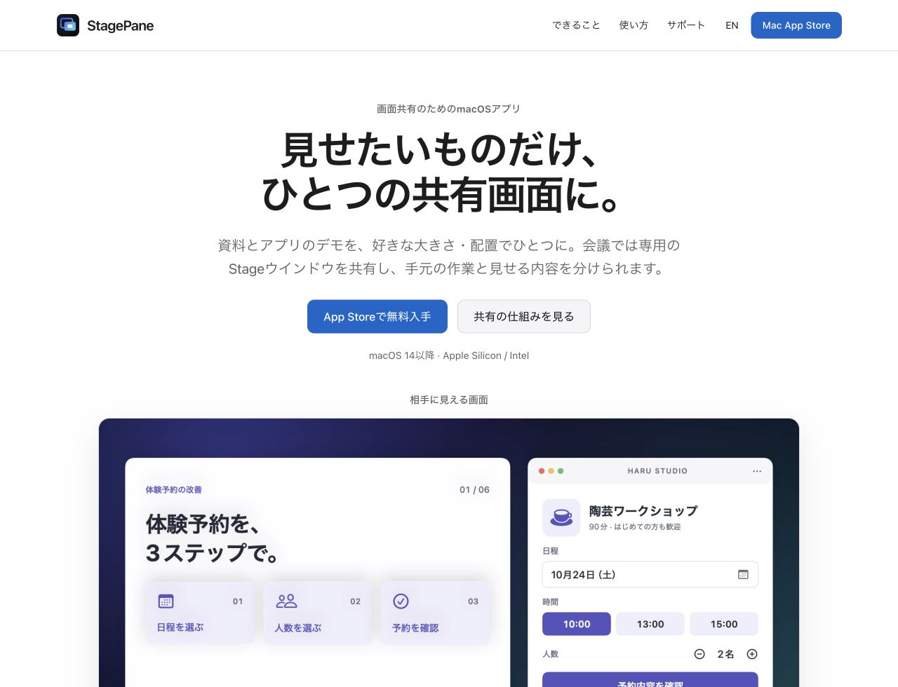
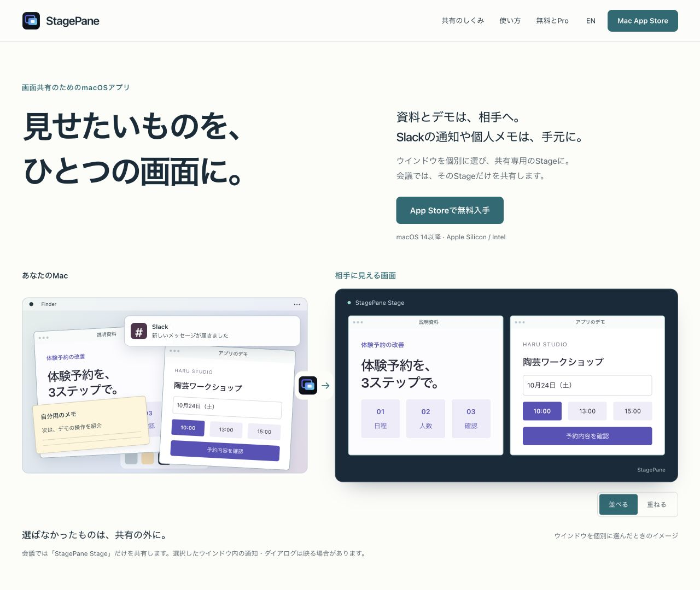

# 画面共有のLP再構成 — レビュー記録

2026-10-21。対象: [企画issue #29](https://github.com/hinoshiba/StagePane/issues/29)。
基準アプリ: `568cf16`（Settings集約後のmain）。アプリの動作は変更しない。

## 構成と判断

手元のMacと共有先のStageを同じ架空資料で対比し、選択外の通知・メモが
共有に含まれない仕組みを示す。図の「並べる／重ねる」は共有側だけを変える。
実際の入力転送やOS仮想ディスプレイではなく、配置のイメージとして表示する。

続けて現在のWorkspace、説明用の道具、ローカル処理、3ステップ、無料とPro、
5つのFAQを配置。均等な機能カードと末尾の繰り返しCTAを削り、料金のそばに
入手リンクを置いた。既存の法務本文・深いリンク・GitHub Pages構成は維持。
保存設定の説明だけを現行アプリと同期した。

## 独立レビューと反映

実装担当と別の3エージェントが、製品・共有範囲、視覚・編集、実装・整合性を担当。
初稿の指摘を修正し、更新後のソースとブラウザ画像を再レビューした。

| 指摘 | 反映 |
| --- | --- |
| 大きなサンプルStageだけでは選択共有の理由が見えない | 手元／共有先の対比を先頭に配置 |
| 通知の分離条件が検索・SNSカードから抜ける | Heroとメタ説明にも個別選択・Stageのみ共有を明示 |
| 図と実画面で題材が変わる | 予約資料と予約デモに統一 |
| 手元のメモが隠れ、図の下端が切れる | 図の寸法・重なり・文字サイズを調整 |
| モバイルの説明が長い | 小見出しと余白を削減、ローカル処理帯を圧縮 |
| FAQと価格の言葉が入口として重い | FAQを5項目に整理、無料4の単位を「画面」に変更 |
| 初期カーテンを開く手順が抜ける | 共有先の確認後にカーテンを開く手順を復元 |
| 英語で改行を隠すと文が連結する | 英文の改行前にスペースを保持 |
| 料金の単位が1文字だけ折り返す | 「同時に使える画面」に短縮 |
| 画像拡大が見つけづらい | 画像リンクに「拡大」を表示 |

「通知を必ず隠す」「漏洩ゼロ」「日本一」など、検証できない保証・順位は掲載しない。
選択ウインドウ内の通知・ダイアログが映る条件、カーテン／切り抜きでは
取得が続くこと、会議への配信は会議アプリが担うことを保持した。

## 検証

- 日英、幅320・390・768・1280・1440pxの表示確認。主要画面に横はみ出し・画像欠落なし。
- ブラウザで図の配置切替、キーボードによる操作、skip-link、FAQ、モバイルメニューの
  閉鎖と移動先へのフォーカス、言語切替と履歴、ハッシュ維持、画像リンクを確認。
- macOSのアクセシビリティツリーで見出し、リンク、開閉状態、図の代替説明を確認。
- ライト表示に加え、独立した検証用コピーでdark・prefers-contrast・reduced-motionの
  CSS分岐を強制して描画確認。dark画像と拡大先の一致、動き抑制時のアニメーション0・
  transition 0秒・scroll-behavior autoを確認。実機OS設定の切替テストとは区別する。
- 静的英語プライバシーページはモバイル表示と翻訳本文6段落の完全一致を確認。
- HTML構造、翻訳キー、内部リンク、画像、JavaScript構文、メタ情報と構造化データを確認。
  ブラウザの警告・エラーなし。外部フォント、依存ライブラリ、追跡処理の追加なし。
- `Scripts/release-check.sh` 成功（233テスト、失敗0）。strict concurrency build成功。
- VoiceOverの音声を伴う実走、実会議への接続、実機モバイル、別ブラウザエンジンは
  今回の検証範囲外。アクセシビリティ適合認証や利用者テスト完了を意味しない。

公開画像はすべて架空の内容。現在の実アプリ画像6点はメタデータなしのWebP。
画像・CSS・JavaScriptの参照を更新し、旧キャッシュとの混在を避ける。

## 比較

更新前（1280px）:

更新後（1280px）:

